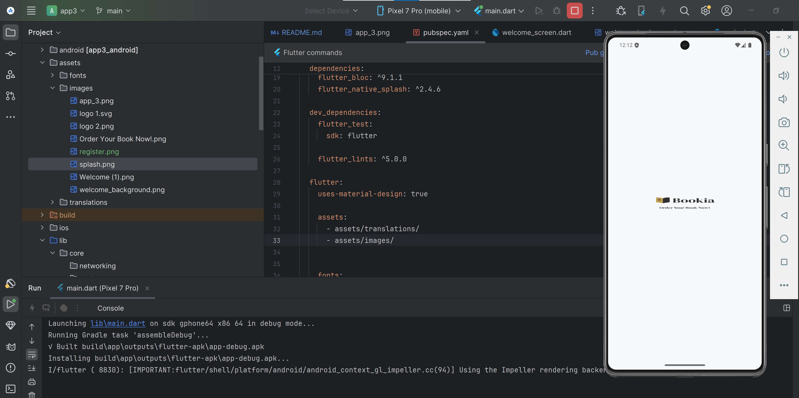
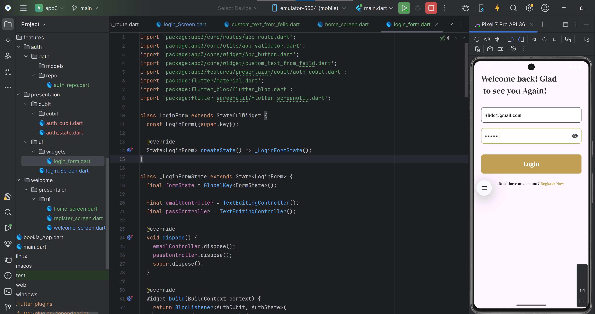
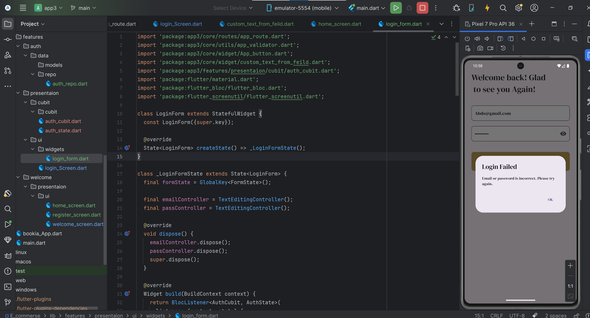
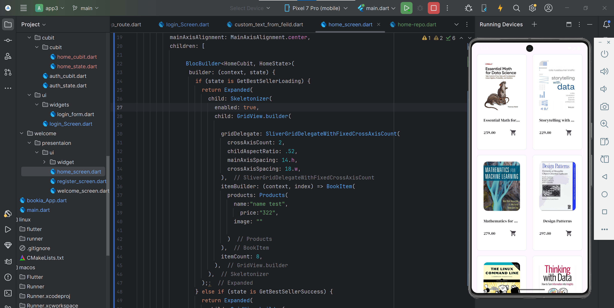
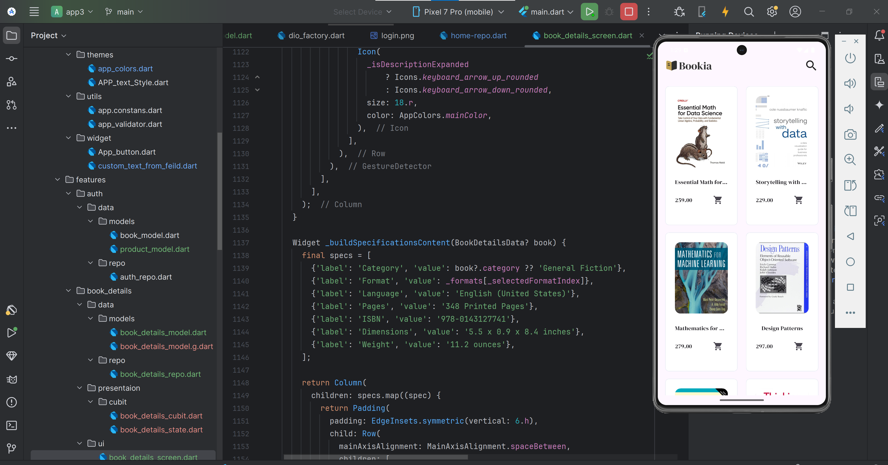
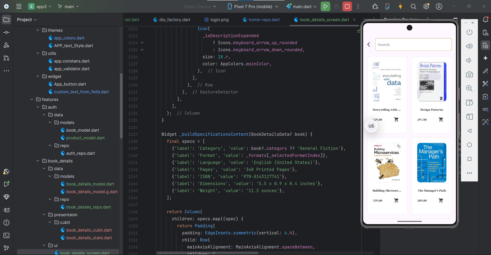
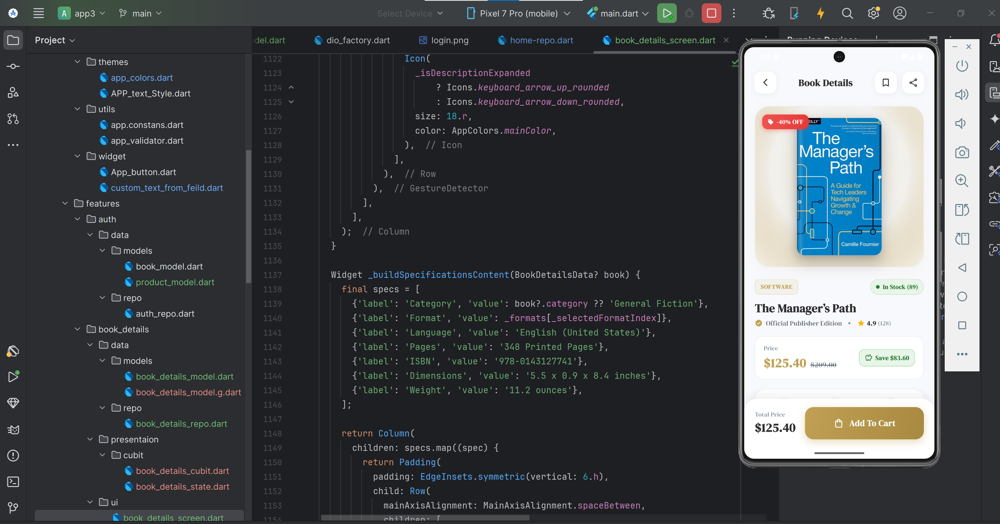
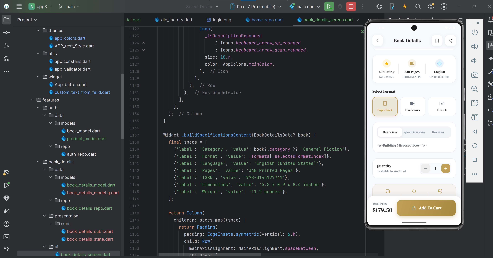

# 📚 Bookia App

A modern mobile application built with **Flutter and Dart**, designed to provide users with a simple and enjoyable experience for browsing books and exploring book-related content.

The project follows a modular structure to keep the code organized, reusable, and easy to maintain.

## 📱 Screenshots

### Welcome & Splash Screen

<p align="center">
  
  
</p>

### Authentication Screens

<p align="center">
  
  
</p>

### Authentication Error State

<p align="center">
  
</p>

### Home Screen

<p align="center">
  
</p>

> **Note:** Make sure all screenshot paths match the actual image locations in the repository. GitHub paths are case-sensitive, and filenames containing spaces must match exactly.

## ✨ Features

### Authentication
 
 
### Details
 
 

* Login screen with email and password fields.
* Registration screen UI.
* Form validation for user input.
* API integration using Dio.
* Loading indicators during login requests.
* Success and error states managed by Cubit.
* Navigation after successful authentication.

### Home & Books

* Home feature organized into separate components.
* Best Seller Books API integration.
* Repository-based data fetching.
* Loading, success, and error states for book requests.
* Book data handling through `BookModel`.
* Separation of networking logic from UI and state management.

### Application Architecture

* State management using Cubit and `flutter_bloc`.
* Centralized API endpoint configuration.
* Centralized named routes.
* Reusable UI components.
* Responsive layouts using Flutter ScreenUtil.
* Localization support using Easy Localization.

## 🛠️ Technologies Used

| Technology         | Purpose                                    |
| ------------------ | ------------------------------------------ |
| Flutter            | Building the mobile application            |
| Dart               | Application programming language           |
| flutter_bloc       | State management                           |
| Cubit              | Managing authentication and home states    |
| Dio                | Sending HTTP requests to APIs              |
| BookModel          | Representing book data returned by the API |
| Repository Pattern | Separating data access from business logic |
| Flutter ScreenUtil | Responsive sizing and spacing              |
| Easy Localization  | Supporting multiple languages              |
| Material Design    | Building the user interface                |

## 🔐 Authentication

The authentication feature is organized into separate components to improve maintainability.

### Login

The login flow includes:

* Email and password input fields.
* Form validation before submitting credentials.
* API requests using Dio.
* Loading state while waiting for the response.
* Success and error states managed by `AuthCubit`.
* Navigation to the home screen after successful login.

### Register

The registration interface includes the following fields:

* Username
* Email
* Password
* Confirm Password

The registration screen is developed separately from the login screen.

> **Note:** The registration interface does not necessarily mean that registration is connected to a working API endpoint.

## 📚 Home Feature & Best Seller Books

The Home feature is responsible for retrieving and displaying book-related data.

### Best Seller API

The application uses an API endpoint to request the best-selling books.

The endpoint configuration is organized using the `ApiEndPoint` class.

Example:

```dart
class ApiEndPoint {
  static const String baseUrl =
      'https://codingarabic.eraapro.com/api';

  static const String login = 'login';

  static const String bestSeller = 'products-bestseller';
}
```

The base URL and endpoint paths are stored in one place to make API configuration easier to maintain.

The Best Seller endpoint can be combined with the base URL to construct the request URL:

```dart
final url = '${ApiEndPoint.baseUrl}/${ApiEndPoint.bestSeller}';
```

The resulting URL is:

```text
https://codingarabic.eraapro.com/api/products-bestseller
```

> **Note:** The endpoint above reflects the configuration used during development. Its availability and the correctness of the server URL must be verified against the current API documentation.

### BookModel

`BookModel` is used to represent the book data received from the API.

The model helps organize the response data so that the application can access the book information through Dart objects instead of handling raw JSON throughout the UI.

### HomeRepo

`HomeRepo` is responsible for retrieving Best Seller book data.

The repository separates data-fetching operations from the Cubit and UI layers.

This organization makes the code easier to maintain and allows API-related logic to remain separate from presentation logic.

### HomeCubit

`HomeCubit` manages the state of the Best Seller books request.

It calls the repository, waits for the response, and emits the appropriate state for the UI.

The main method is:

```dart
getBestSellerBox()
```

The method starts by emitting a loading state, requests the data from `HomeRepo`, and then emits either a success or error state.

### Home States

The Home feature uses the following states:

| State                  | Purpose                                   |
| ---------------------- | ----------------------------------------- |
| `HomeInitial`          | Initial state before a request begins     |
| `GetBestSellerLoading` | Indicates that the books are being loaded |
| `GetBestSellerSuccess` | Indicates that the request succeeded      |
| `GetBestSellerError`   | Indicates that the request failed         |

These states allow the UI to respond to different stages of the API request.

### Request Flow

The Best Seller request follows this sequence:

1. The UI triggers `HomeCubit.getBestSellerBox()`.
2. `HomeCubit` emits `GetBestSellerLoading`.
3. `HomeCubit` calls `HomeRepo`.
4. `HomeRepo` retrieves the data from the API.
5. The response is handled using `BookModel`.
6. `HomeCubit` emits `GetBestSellerSuccess` when the response is valid.
7. If the request fails, `HomeCubit` emits `GetBestSellerError`.
8. The UI can use these states to display a loading indicator, book data, or an error message.

## 🔄 State Management

The application uses **Cubit** from the `flutter_bloc` package to manage application states.

### Authentication States

The login feature uses:

* `AuthInitial`
* `LoginLoadingState`
* `LoginSuccessState`
* `LoginErrorState`

### Home States

The Best Seller feature uses:

* `HomeInitial`
* `GetBestSellerLoading`
* `GetBestSellerSuccess`
* `GetBestSellerError`

Using separate Cubits and states helps keep authentication logic independent from book-related operations.

## 🌐 API Integration

The application uses **Dio** to communicate with REST APIs.

The networking and data flow are organized into separate responsibilities:

* **ApiEndPoint:** Stores the base URL and endpoint paths.
* **Repository:** Handles data-fetching operations.
* **Model:** Represents the response data.
* **Cubit:** Manages loading, success, and error states.
* **UI:** Displays the appropriate content based on the current state.

This separation makes the application easier to understand, test, and maintain.

## 🧭 Navigation

The application uses centralized named routing through `AppRouter`.

The documented routes include:

* Login Screen
* Register Screen
* Welcome Screen
* Home Screen

`BlocProvider` is used to provide Cubits to the screens that need them.

For example, a screen can receive a Cubit through `BlocProvider` and listen to its state changes using the appropriate Bloc widgets.

## 🎨 Reusable Components

The project includes reusable components to help maintain a consistent design.

* `AppButton`: A customizable button with configurable text and colors.
* `CustomTextFromFeild`: A reusable text field component.
* `AppTextStyle`: Centralized text styling.
* `AppColors`: Centralized application colors.
* `AppValidator`: Validation helpers for user input.

## 🌍 Supported Languages

The project includes localization support using Easy Localization.

Currently configured languages:

* 🇬🇧 English
* 🇩🇪 German

The actual languages available to users depend on the localization files and the application's locale configuration.

## 📂 Project Structure

The following structure documents the main components discussed during development. Update it to match the actual files in your project.

```text
app3/
├── assets/
│   ├── images/
│   └── translations/
│
├── lib/
│   ├── core/
│   │   ├── networking/
│   │   │   └── api_end_point.dart
│   │   ├── routes/
│   │   │   ├── app_route.dart
│   │   │   └── app_router.dart
│   │   ├── themes/
│   │   │   ├── app_colors.dart
│   │   │   └── APP_text_Style.dart
│   │   ├── utils/
│   │   │   └── app_validator.dart
│   │   └── widget/
│   │       ├── App_button.dart
│   │       └── custom_text_from_feild.dart
│   │
│   ├── features/
│   │   ├── auth/
│   │   │   └── data/
│   │   │       ├── models/
│   │   │       │   └── book_model.dart
│   │   │       └── repo/
│   │   │           ├── auth_repo.dart
│   │   │           └── home-repo.dart
│   │   │
│   │   └── presentaion/
│   │       ├── cubit/
│   │       │   ├── auth_cubit.dart
│   │       │   ├── auth_state.dart
│   │       │   ├── home_cubit.dart
│   │       │   └── home_state.dart
│   │       └── ui/
│   │           ├── login_Screen.dart
│   │           ├── register_screen.dart
│   │           └── widgets/
│   │               └── login_form.dart
│   │
│   ├── bookia_App.dart
│   └── main.dart
│
├── README.md
└── pubspec.yaml
```

> **Important:** The file tree is illustrative. Keep only the folders and filenames that actually exist in your repository. In particular, the exact location of `HomeCubit`, `HomeState`, and `BookModel` should match your project.

## 🚀 Getting Started

### Prerequisites

Before running the project, make sure you have installed:

* Flutter SDK
* Dart SDK
* Android Studio or Visual Studio Code
* An Android emulator or a physical device

### Installation

1. Clone the repository:

   ```bash
   git clone YOUR_REPOSITORY_URL
   ```

2. Navigate to the project directory:

   ```bash
   cd app3
   ```

3. Install the dependencies:

   ```bash
   flutter pub get
   ```

4. Check the available devices:

   ```bash
   flutter devices
   ```

5. Run the application:

   ```bash
   flutter run
   ```

## 📦 Dependencies

The project uses packages such as:

* `flutter_bloc`
* `bloc`
* `dio`
* `meta`
* `flutter_screenutil`
* `easy_localization`

Run the following command to install the dependencies declared in `pubspec.yaml`:

```bash
flutter pub get
```

## 🎯 Project Goals

* Build a clean and responsive Flutter application.
* Practice reusable widget development.
* Implement form validation.
* Integrate REST APIs using Dio.
* Organize API endpoints in a centralized class.
* Represent API responses using data models.
* Separate data fetching into repository classes.
* Manage authentication and book-loading states with Cubit.
* Organize navigation using named routes.
* Separate UI, state management, and networking logic.
* Practice building maintainable Flutter applications.

## 👨‍💻 Author

Developed as a Flutter learning project to practice mobile application development, authentication, API integration, state management, and clean code organization.
