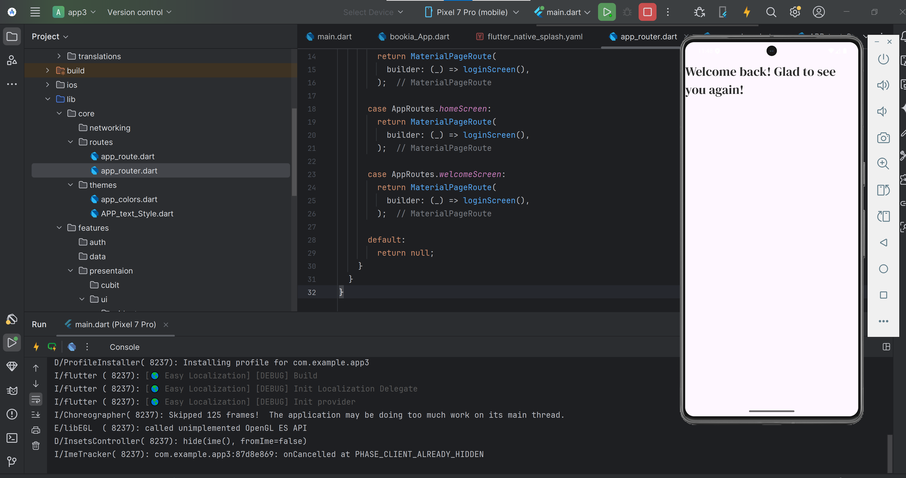
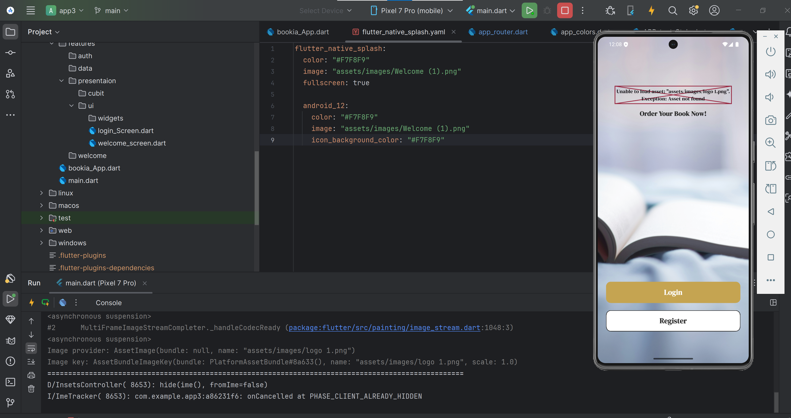

# Bookia App 📚

## 📖 About the Project

Bookia is a mobile application built with Flutter. The project aims to provide users with a simple and enjoyable experience for browsing books and exploring book-related content.

The application is structured using a modular architecture to make the code easier to maintain, organize, and extend.

## 📱 Welcome / Splash Screen

The application starts with a Welcome or Splash screen that introduces users to Bookia before they navigate through the application.


> Note: Add your Welcome or Splash screen image to `assets/images/welcome_splash.png` to display it here on GitHub.

## 🛠️ Technologies Used

- **Flutter:** For building the mobile application.
- **Dart:** The programming language used in the project.
- **Easy Localization:** For supporting multiple languages.
- **Flutter ScreenUtil:** For creating responsive user interfaces.
- **Material Design:** For designing the application interface.

## 🌍 Supported Languages

- English 🇬🇧
- German 🇩🇪

## 📂 Project Structure




```text
lib/
├── core/
│   ├── networking/
│   ├── routes/
│   │   ├── app_route.dart
│   │   └── app_router.dart
│   └── themes/
│       ├── app_colors.dart
│       └── APP_text_Style.dart
│
├── features/
│   ├── auth/
│   ├── data/
│   └── presentaion/
│       ├── cubit/
│       └── ui/
│
├── bookia_App.dart
└── main.dart